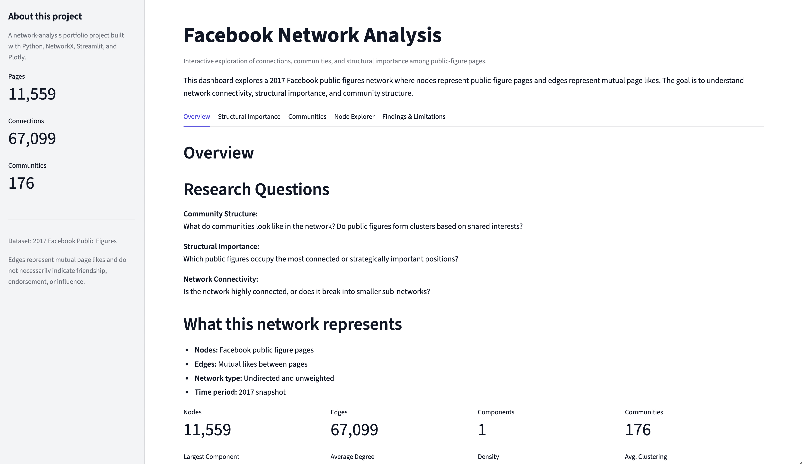

# Facebook Network Analysis

An interactive data science project that analyzes connections among public-figure pages in a 2017 Facebook network.

The Streamlit dashboard combines graph preprocessing, network statistics, centrality analysis, community detection, and interactive Plotly visualizations. It helps users explore how pages connect globally, which nodes occupy important structural positions, and how individual pages fit into local neighborhoods.

## Dashboard Preview



## Live Demo

[Open the live dashboard](https://facebook-network-analysis-bdqcdduwxxjd2bunc3bwtf.streamlit.app/)

## Highlights

- Analyzed **11,559 nodes** and **67,099 connections**
- Identified **176 network communities**
- Calculated degree, degree centrality, betweenness, clustering, density, and connectivity metrics
- Built interactive views for centrality rankings, community structure, and ego networks
- Added name search and node-level exploration for practical dashboard use

## Tech Stack

Python · pandas · NetworkX · Streamlit · Plotly

## Dataset

The project uses the [GEMSEC Facebook Public Figures dataset](https://memetracker.stanford.edu/data/gemsec-Facebook.html), collected in November 2017. The repository contains the raw node and edge files used for this analysis.

- **Nodes:** public-figure Facebook pages
- **Edges:** mutual likes between pages
- **Network:** undirected and unweighted

The processed graph contains 11,559 nodes and 67,099 edges after validation and preprocessing.

This is a historical network snapshot. A connection represents a mutual page like; it should not automatically be interpreted as friendship, endorsement, collaboration, or real-world influence.

## Run Locally

### 1. Create a virtual environment

```bash
python3 -m venv .venv
source .venv/bin/activate
```

### 2. Install dependencies

```bash
python3 -m pip install -r requirements.txt
```

### 3. Generate processed data

The repository includes the processed files needed to launch the dashboard. To rebuild them from the raw dataset:

```bash
python3 preprocessing.py
```

This generates `processed_nodes.csv`, `graph.pkl`, and `summary_stats.pkl`.

### 4. Launch the dashboard

```bash
streamlit run facebook_network_app.py
```

Then open the local URL printed in the terminal, typically `http://localhost:8501`.

## Dashboard Sections

| Section                | What it shows                                                     |
| ---------------------- | ----------------------------------------------------------------- |
| Overview               | Dataset scope and network-level statistics                        |
| Structural Importance  | Top nodes by degree, degree centrality, or betweenness            |
| Communities            | Community sizes and filtered network visualizations               |
| Node Explorer          | Search, neighbors, metrics, and ego networks for individual pages |
| Findings & Limitations | Findings, limitations, and possible next steps                    |

## Key Findings

- The network contains **one connected component**, so every page is reachable from every other page through a chain of connections.
- The graph is sparse, with a density of approximately **0.001**, but the average node still has about **11.6 direct connections**.
- **Oprah Winfrey** has the highest degree in the processed network with **326 direct connections**.
- **Daniel Amos**, **Dwayne The Rock Johnson**, and **Hugh Jackman** rank highly by betweenness, suggesting that they occupy important bridge positions in the graph.
- Community sizes are uneven: the largest detected community contains **4,029 nodes**, while many smaller communities form around more localized patterns.

These findings describe graph structure; they do not establish real-world popularity, endorsement, or influence.

## Testing

Run the repository checks with:

```bash
python3 -m unittest discover -s tests -v
```

## Project Structure

```text
.
├── facebook_network_app.py       # Streamlit dashboard
├── preprocessing.py              # Graph construction and metric generation
├── requirements.txt              # Python dependencies
├── fb-pages-public-figure.nodes  # Raw node data
├── fb-pages-public-figure.edges  # Raw edge data
├── processed_nodes.csv           # Node metrics used by the dashboard
├── graph.pkl                     # Serialized NetworkX graph
├── summary_stats.pkl             # Network-level summary metrics
├── tests/                        # Automated artifact checks
├── assets/                       # README media
└── README.md
```

## Limitations and Future Work

Community detection is algorithmic and may not correspond to meaningful real-world groups. The dataset captures only mutual likes from one historical snapshot and excludes other interactions such as comments, shares, followers, and content similarity.

Potential extensions include adding more centrality measures, improving community labels, comparing multiple time periods, and deploying the dashboard publicly.

## Authors

Josh Guzman · Marco Joson · Alice Nguyen

Course project for CS 4230 — Social Computing.
